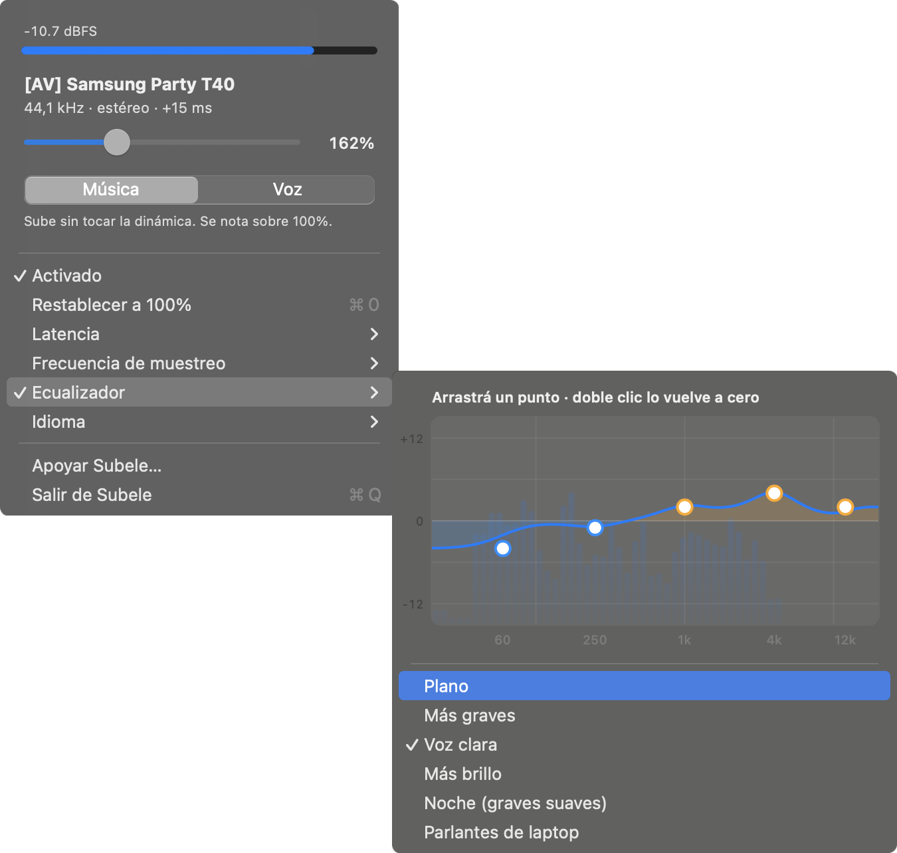
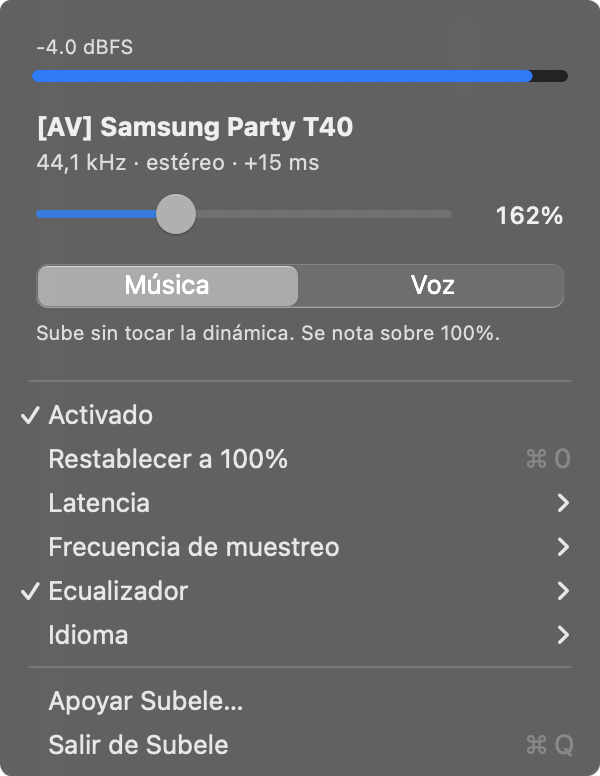

# Subele

[](https://github.com/carlostapiacl/subele/actions/workflows/test.yml)
[](LICENSE)
[](#requisitos)
[](Package.swift)

**Español** · [English](README.en.md)

**Sube macOS más allá del 100% sin instalar drivers, y sin que suene a parlante
reventado.**

Una app de barra de menú. Mueves el slider, el sistema suena más fuerte. Lo raro
está abajo: ninguna extensión de kernel, ningún driver de audio, y tu dispositivo
de salida por defecto nunca queda secuestrado.

Es gratis y de código abierto. Si te sirve, [se agradece una donación](https://paypal.me/carlostapiacl);
si no, úsala igual. *(Antes se llamaba audio-booster.)*

<p align="center"></p>

---

## Por qué existe

Durante una década los amplificadores de volumen de macOS funcionaron igual.
Boom 3D, eqMac y el resto instalan un `AudioServerPlugIn` en
`/Library/Audio/Plug-Ins/HAL`, se ponen como salida por defecto del sistema y
pasan el audio hacia el hardware real. Eso implica un driver que firmar, un
instalador, `sudo`, tu salida secuestrada sin avisar, y algo que se rompe cada vez
que Apple saca una actualización.

**macOS 14.2 volvió todo eso innecesario.** `AudioHardwareCreateProcessTap` es una
API pública que captura lo que otros procesos están reproduciendo, sin driver de
por medio. Este proyecto está construido sobre eso, y no es el único:
[FineTune](https://github.com/ronitsingh10/FineTune) también usa taps y hace mucho
más (volumen por app, ruteo, AutoEQ). Lo que separa a Subele es cómo sube.

|  | boosters con driver | Subele |
| --- | --- | --- |
| Instala driver | sí, con `sudo` | no |
| Toma la salida por defecto | sí | **no** |
| Desinstalar | sacar el driver | borrar la app |

Multiplicar una señal por tres significa que todo lo que pasaba de un tercio de
escala se pasa del máximo, y hay que hacer algo con eso. Recortar o redondear cada
muestra que se pasa, que es lo que hace un *soft clipper*, deforma la onda, y de
ahí sale ese sonido fino y a lata del "volumen aumentado". Un limitador que ve el pico antes de que
llegue baja la ganancia entera y no deforma nada. Con un seno de 1 kHz a 400 %, el
soft limiter que publica FineTune da 23 % de distorsión armónica entrando a −6 dBFS
(`Tools/thd-softclip.py`); Subele da 0,0004 % con la misma señal (test
`boostingDoesNotDistort`). Es una señal de prueba, y todavía falta medirlo
grabando la salida de cada app (por confirmar).

## Cómo funciona

```
procesos del sistema ──┐
                       ├──→ [ process tap ] ──→ IOProc ──→ ganancia
                       │      silenciado                       ↓
                       │      al tapearse                 ecualizador
                       │                                       ↓
                       │                         compresor + makeup   (modo Voz)
                       │                                       ↓
                       │                    limitador brickwall, 3 ms de lookahead
                       │                                       ↓
este proceso ──────────┴──── excluido del tap ────→ dispositivo de salida
```

1. Un **process tap** captura todo lo que va al dispositivo de salida por defecto,
   con nuestro propio proceso excluido — si no, lo que escribimos se capturaría y
   volvería a entrar. `muteBehavior = .mutedWhenTapped` silencia el camino
   original, así el audio se escucha una vez, a través nuestro.
2. Un **dispositivo agregado privado** junta el tap (entrada) con el hardware real
   (salida), así un solo callback del IOProc tiene las dos puntas.
3. El callback procesa y escribe de vuelta.

Dos detalles que no se ven en el diagrama:

- **El agregado trae también las entradas del hardware.** Si la salida es una
  interfaz USB o unos audífonos con micrófono, la entrada del callback es
  "micrófono + tap", con el micrófono primero. El motor ubica qué buffers son del
  tap (`IORenderer.tapBufferRange`) y lee solo esos: tomar el primero reproducía
  el micrófono por los parlantes.
- **Todo lo que se puede rechazar se rechaza antes de crear el tap.** El formato
  de la salida (float32 nativo, hasta 32 canales) se valida primero; mientras no
  hay tap el sistema suena como siempre. Si algo falla después, la cadena se
  desarma entera y el tap se destruye, que es lo que devuelve el audio.

`start` y `stop` corren en una cola propia (`EngineController`), nunca en la de
la interfaz: CoreAudio puede bloquearse, y el menú tiene que seguir respondiendo
para decirlo. Un watchdog revisa que el IOProc siga girando y, si se detiene,
rehace la cadena: un tap que silencia a todos con un IOProc parado es un Mac mudo.

La salida por defecto del sistema nunca cambia. El menú de volumen sigue diciendo
"MacBook Pro (bocinas)", porque siguen siendo las bocinas del MacBook Pro.

## El limitador

Esta es la parte por la que vale la pena leer el código.

1. La señal se retrasa 3 ms.
2. Para cada frame que entra se calcula la ganancia que ese frame necesitaría para
   no pasar el techo.
3. Una **cola monótona** mantiene el mínimo corrido de esas ganancias sobre toda
   la ventana de lookahead, en O(1) amortizado por muestra.
4. El frame que sale de la línea de retardo se multiplica por la ganancia más baja
   que vaya a exigir cualquier frame entre él y el presente.

El paso 3 es el que es fácil de errar, y este proyecto lo erró primero. Suavizar
la ganancia con ataque y release en vez de tomar el mínimo de la ventana deja que
el release vaya subiendo la ganancia durante esos 3 ms. El limitador entonces
desborda unos 0,3 dB — suficiente para llegar a fondo de escala y clipear, en
silencio, justo en los transitorios fuertes que uno quería proteger. Con el mínimo
de la ventana, desbordar es imposible por construcción y no por haber ajustado
constantes hasta que se viera bien.

Hay un test para eso: una señal que salta de silencio a fondo de escala con 400%
de ganancia aterriza en el techo, no lo atraviesa.

**El techo es de true peak, no solo de muestras.** Entre dos muestras bajo el
techo, la onda que reconstruye el conversor puede pasarlo: un seno a un cuarto de
la frecuencia de muestreo con fase de 45° tiene todas sus muestras a −3 dBFS y
llega a 0 dBFS de verdad. El paso 2 mira la muestra y tres puntos interpolados
hasta la siguiente (sobremuestreo ×4, como ITU-R BS.1770) y calcula la ganancia
contra el mayor. Es una estimación hecha con un interpolador de 12 muestras, y el test de ese
seno exige que la salida quede a 0,1 dB del techo.

La ganancia del slider tampoco salta: persigue al valor nuevo en unos 10 ms, así
pasar de 100% a 400% no hace clic.

## Modos

- **Música** — solo ganancia y limitación. Dinámica intacta: lo que sonaba
  fuerte respecto de lo que sonaba bajo sigue igual. **Con la ganancia en 100%
  casi no hace nada, a propósito**: solo toca los picos que ya vengan sobre el
  techo de −0,3 dBFS, que en material bien masterizado son pocos o ninguno. Se
  nota al subir, cuando el limitador empieza a trabajar. El panel lo dice debajo del selector, porque fue lo primero que
  preguntó alguien que la probó.
- **Voz** — agrega compresión con makeup automático, que sube lo bajo en vez de
  aplastar lo alto. Para voz, llamadas y video con audio flojo. Este sí se nota
  en 100%.

(En versiones anteriores se llamaban *Transparente* y *Loudness*.)

El makeup no es un detalle, es la razón misma de poner un compresor ahí. Un
compresor sin makeup hace el audio *más bajo*. La primera versión de este DSP
salió con ese error y medía más bajo a 300% de ganancia que a 100%. También hay un
test que lo deja clavado.

## Ecualizador

Cinco bandas, ±12 dB: un shelf de graves en 60 Hz, campanas en 250 Hz, 1 kHz y
4 kHz, y un shelf de agudos en 12 kHz. Son biquads del cookbook de Robert
Bristow-Johnson con estado en doble precisión, y van **antes** del compresor y del
limitador: subir los graves agrega energía, y puesto ahí el limitador ve ese pico
como cualquier otro en vez de dejarlo clipear.

Se maneja como gráfico: la curva de respuesta real —calculada con los mismos
biquads que procesan el audio, así que lo que se ve es lo que suena— con un punto
por banda que se arrastra, doble clic para volverlo a cero y la rueda del mouse
para ajuste fino. Detrás corre el espectro de lo que está sonando (FFT de 4096
puntos con Accelerate, en el hilo de la interfaz y solo con el ecualizador
abierto). Trae presets como punto de partida: Plano, Más graves, Voz clara, Más
brillo, Noche y Parlantes de laptop.

Con todas las bandas en 0 dB la salida es idéntica bit a bit a la entrada. Hay un
test para eso, otro que comprueba que cada banda sube lo que dice y otro que lo
pone todo a +12 dB en cinco frecuencias de muestreo para ver que nada se vuelva
inestable.

## Frecuencia de muestreo

El menú **Frecuencia de muestreo** cambia la salida entre las frecuencias que
acepte el dispositivo (44,1, 48, 96 kHz…), lo mismo que hacerlo en Configuración
de Audio MIDI, pero sin saber que esa app existe. El cambio es para todo el
sistema (las otras apps que usan ese dispositivo también pasan a esa frecuencia,
y el menú lo avisa), y la cadena se rehace sola cuando el dispositivo lo termina de aplicar,
también si se cambia desde afuera.

Lo que gana y lo que no: subir de 44,1 a 96 kHz no le agrega detalle a una
grabación de 44,1. Lo que puede cambiar es que macOS deje de convertir de
frecuencia y que la interfaz suene distinto a la frecuencia que prefiere. Hay
gente que lo nota mucho, y antes había que ir a buscarlo a una app escondida.

## Latencia

La cadena cuesta unos **dos períodos de buffer más los 3 ms de lookahead**. Esa
proporción se mantuvo en todos los tamaños de buffer medidos, así que el tamaño de
buffer es la única palanca que la mueve de verdad. Medido sobre los timestamps del
propio IOProc, no estimado:

| buffer | latencia agregada |
| --- | --- |
| 128 frames | 8,8 ms |
| **256 frames (default)** | **14,6 ms** |
| 512 frames (lo que elige CoreAudio) | 26,2 ms |

A la música no le va a importar en ninguno de los tres. Al video puede que sí:
26 ms es más o menos donde el desfase de labios empieza a notarse, y por eso el
default es 256 y no lo que CoreAudio entrega solo. El ajuste está en **Latencia**,
dentro del menú.

## Idioma

La interfaz viene en español e inglés, con selector en el menú (**Idioma**). Por
defecto sigue al idioma del sistema. La consola usa el mismo ajuste.

## Requisitos

macOS 14.2 o posterior, Intel o Apple Silicon (el `.dmg` trae un binario
universal), y la cadena de herramientas de Swift para compilar. Las Command Line
Tools de Xcode alcanzan: este proyecto se compila sin Xcode.

## Instalación

### Descargar

> Gratis. Si te sirve: [donar por PayPal](https://paypal.me/carlostapiacl).

Baja el `.dmg` de la [última versión](https://github.com/carlostapiacl/subele/releases/latest),
ábrelo y arrastra **Subele** a Aplicaciones.

**La primera vez macOS la va a bloquear.** La app está firmada ad-hoc pero **no
notarizada**: notarizar exige una cuenta de Apple Developer de pago (USD 99 al
año). Vas a ver *"Apple no pudo verificar que esté libre de malware"*. Para
destrabarla, una de estas dos:

- **Ajustes del Sistema → Privacidad y seguridad**, baja hasta el aviso sobre
  Subele y toca **Abrir igualmente**.
- O en la Terminal:
  ```bash
  xattr -d com.apple.quarantine "/Applications/Subele.app"
  ```

En macOS 15 el viejo truco de Control-clic → Abrir ya no alcanza; hay que pasar
por Ajustes del Sistema.

### Compilar

Si prefieres no confiar en un binario sin notarizar, son unos
segundos:

```bash
git clone https://github.com/carlostapiacl/subele
cd subele
./build-app.sh
open "Subele.app"
```

`build-app.sh` compila release, corre los tests, genera el ícono, arma el `.app` a
mano (SwiftPM no produce bundles) y lo firma ad-hoc. La firma ad-hoc alcanza para
correrlo en la máquina que lo compiló; distribuirlo pediría un certificado
Developer ID y notarización.

`Tools/make-dmg.sh` arma el `.dmg` descargable, y el workflow `release.yml` lo
publica solo al empujar una etiqueta `v*`: compila en GitHub, no en una máquina
personal, publica el SHA-256 de cada `.dmg` y una atestación de procedencia que
ata el archivo a este repositorio y a este workflow. Para verificar uno
descargado:

```bash
shasum -a 256 -c SHA256SUMS.txt
gh attestation verify subele-*.dmg --repo carlostapiacl/subele
```

No reemplaza la notarización de Apple, pero deja comprobar que el `.dmg` salió de
este código. Las Actions del workflow van fijadas por SHA y cada job tiene solo
los permisos que usa.

El ícono se genera por código en `Tools/make-icon.swift`, así que se revisa en
diff como cualquier otro archivo en vez de ser un binario opaco. Dibuja un dial
que pasa del máximo —arco blanco hasta el tope, ámbar siguiendo más allá— con un
parlante al centro. El ámbar es el mismo color que usa el medidor cuando el
limitador trabaja. El de la barra de menú repite la idea en monocromo: **el arco
sigue más allá del tope solo cuando la ganancia pasa de 100%**, así se sabe de un
vistazo si está amplificando. El porcentaje aparece al lado.

## Uso

<p align="center"></p>

Aparece un ícono de parlante en la barra de menú. Al abrirlo: el dispositivo de
salida y su formato, un medidor de nivel que se pone naranja mientras el limitador
trabaja, un slider de 50 a 400%, el selector de modo con lo que hace cada uno, y los menús
de latencia, frecuencia de muestreo, ecualizador e idioma.

La ganancia, el modo, el ecualizador, la latencia y el idioma se guardan entre
sesiones. La frecuencia de muestreo no la guarda la app: es del dispositivo, y
macOS ya la recuerda.

Todo lo que cruza entre la interfaz y el hilo de audio —ganancia, modo, bandas
del ecualizador y medidores— pasa por atómicos (`Sources/CAtomics`, porque el
`Atomic` de Swift exige macOS 15).

Un binario, dos caras — el bundle `.app` solo lo envuelve:

```bash
subele              # app de barra de menú
subele --cli        # consola interactiva
subele --cli --buffer 128
subele --help
```

`SUBELE_TRACE=1` traza cada paso del arranque a stderr. Las llamadas a CoreAudio
pueden bloquearse indefinidamente sin devolver error, y con stdout bufferizado un
cuelgue así no deja ningún rastro.

## Tests

```bash
swift test
```

Ningún test toca hardware: el DSP es procesamiento de señal puro, y el motor corre
sobre una HAL simulada (`Tests/BoosterKitTests/FakeAudioHAL.swift`). Sin
dispositivo de audio, sin tap, sin permisos, así que corren en CI igual que en
un laptop. Eso es
deliberado: medir por los parlantes no sirve, porque cualquier otra cosa que suene
en la máquina se mezcla en el tap y contamina el medidor. Se perdieron dos rondas
de mediciones por música de fondo antes de que los tests se fueran del hardware.

Lo que dejan clavado: ganancia exacta mientras haya headroom, el limitador
llegando al techo pero nunca pasándolo, transitorios de silencio a fondo de
escala, salida idéntica bit a bit entre bloques de 32 y de 1024, el ecualizador
plano sin tocar un bit y cada banda subiendo lo que dice, conteos de canales
de mono a 32, la curva dibujada coincidiendo con un seno filtrado
de verdad, el analizador de espectro ubicando un tono, NaN o infinito llegando a la entrada sin matar la
cadena, picos entre muestras limitados, y la ganancia cambiando en rampa.

Y del motor, sobre la HAL simulada: una interfaz dúplex que nunca reproduce el
micrófono, un buffer nulo que no silencia a los demás, callbacks más largos que
el buffer de trabajo, formatos incompatibles (16 bits, float64, big-endian, más
de 32 canales) rechazados antes de crear el tap, un agregado que tarda en estar
listo, un `AudioDeviceStop` que falla sin dejar memoria liberada bajo un
callback vivo, cien arranques y paradas sin perder recursos, y el watchdog
rehaciendo la cadena cuando el IOProc se detiene, o rindiéndose si no sirve.

Lo que **no** cubren y queda para hardware real (por confirmar): interfaces USB
dúplex concretas, desconectar un Bluetooth mientras suena, y el arranque sin
permiso de captura.

## Limitaciones conocidas

- **Otro booster con driver lo cuelga.** Si eqMac o Boom 3D está corriendo, es
  dueño de la salida por defecto, así que tapeamos *su* dispositivo virtual, que a
  su vez está pasando audio. `AudioDeviceCreateIOProcIDWithBlock` entonces bloquea
  para siempre sin dar error. Hay que cerrarlo primero.
- **AirPlay, sin confirmar.** Los parlantes AirPlay tienen su propio buffer de
  unos dos segundos y no está probado que el dispositivo agregado los acepte como
  salida (por confirmar). Un Bluetooth sí funciona.
- **El modo Voz sube el piso de ruido**, porque el makeup también se aplica
  cuando no hay señal. Es inherente al modo, no un defecto.
- **No arranca al iniciar sesión.** A propósito: no se instala un elemento de
  arranque sin que lo pidan.

## Estructura

```
Sources/CAtomics/            cargas y guardas atómicas para los parámetros
Sources/BoosterKit/          la parte reutilizable, sin AppKit
  Booster.swift              la versión, única fuente de verdad
  Atomics.swift              Float y UInt32 atómicos sobre CAtomics
  CoreAudio/
    AudioObject.swift        envoltorio tipado de la API de propiedades, errores, traza
    AudioDevices.swift       consultas de dispositivos, streams y observadores
    AudioHAL.swift           lo que el motor le pide a CoreAudio, como protocolo
    ProcessTap.swift         crear el tap y leer su formato
    AggregateDevice.swift    crear el dispositivo agregado
  DSP/
    Decibels.swift           conversiones a dB y coeficientes de suavizado
    Compressor.swift         curva de rodilla suave y makeup automático
    Equalizer.swift          5 biquads RBJ, coeficientes recalculados en el hilo de audio
    Limiter.swift            línea de retardo, mínimo deslizante y true peak
    BoostProcessor.swift     la cadena
  Analysis/
    SpectrumTap.swift        últimas muestras de la salida, sin locks
    SpectrumAnalyzer.swift   FFT a bandas logarítmicas
  Engine/
    BoostEngine.swift        arma y desarma tap + agregado + IOProc, en orden
    EngineController.swift   cola propia, estados y watchdog
    IORenderer.swift         el callback: ubica el tap, procesa, reparte
    StreamFormat.swift       qué formatos se aceptan
Sources/subele/              el ejecutable
  main.swift                 elige el modo según los argumentos
  EqualizerView.swift        el ecualizador gráfico
  MenuBarApp.swift           frente en AppKit: arma el menú y muestra el estado
  StatusPanel.swift          el panel de arriba: medidor, slider, modo
  StayOpenMenuRow.swift      fila de menú que no cierra el menú (presets)
  EqualizerPreset.swift      los presets del ecualizador
  AppSettings.swift          lo que se guarda entre sesiones
  MenuBarIcon.swift          ícono de la barra, dibujado por código
  LevelMeterView.swift
  ConsoleMode.swift
  Strings.swift              todo el texto visible, tipado, en dos idiomas
Tools/make-icon.swift        genera AppIcon.icns
Tools/make-og.swift          genera las imágenes para compartir el sitio
Tools/thd-softclip.py        distorsión de un soft limiter por muestra, para comparar
docs/                        el sitio: / en español, /en/ en inglés
Tests/BoosterKitTests/       DSP, renderer, motor y controlador sobre FakeAudioHAL
```

`BoosterKit` no depende de AppKit ni sabe que existe una interfaz, así que el
motor se puede embeber en otra cosa.

## Sitio

[carlostapiacl.github.io/subele](https://carlostapiacl.github.io/subele/) — la página del proyecto, en `docs/`.

## Licencia

MIT © Carlos Tapia
